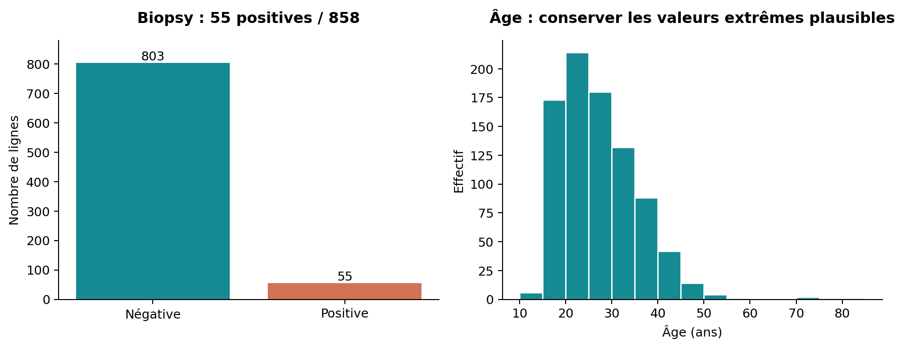
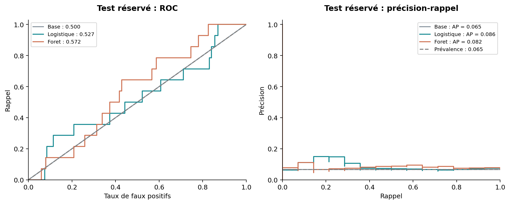
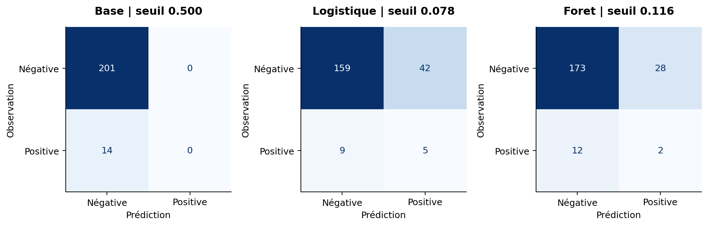
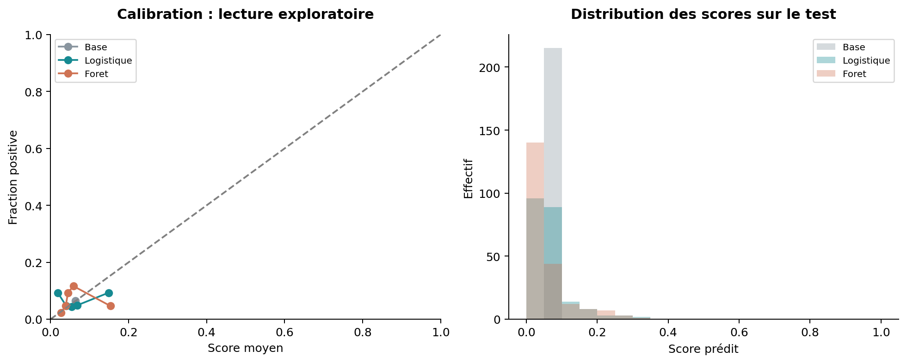
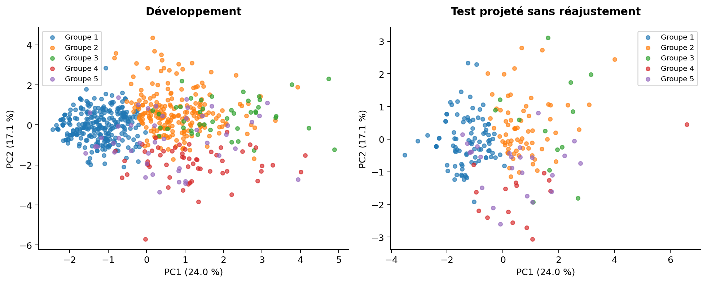
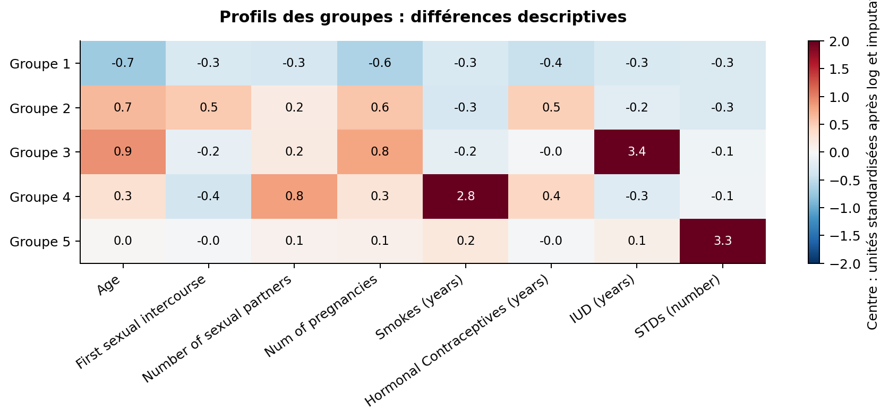

# Facteurs de risque cervicaux

## Analyse Python expliquée, du fichier brut au test réservé

Projet pédagogique - UE 5BM753 - données fournies : 858 dossiers, 36 colonnes.
Analyse réalisée le 13 septembre 2026. Code et rédaction préparés avec assistance
ChatGPT/Codex. Tous les résultats ci-dessous proviennent de l'exécution des scripts
sur le CSV fourni. Aucune contribution humaine individuelle n'est inventée.

### Le résultat à retenir

Les facteurs disponibles permettent d'explorer des profils de patientes, mais
les deux modèles étudiés ne démontrent pas une capacité de prédiction suffisante
sur le test réservé. La forêt, sélectionnée en validation croisée, atteint une
AP test de 0.082, proche de la référence naïve (0.065).
Au seuil choisi en développement, elle détecte 2 biopsies positives
sur 14, avec 28 faux positifs.

Le clustering produit 5 profils stables autour de cet échantillon,
mais leur séparation reste modeste. La vue PCA en deux dimensions ne conserve
que 41.2 % de la variance. Ces groupes décrivent
des caractéristiques de dossiers ; ils ne constituent pas des sous-types de cancer.

Ce rapport explique les choix, les résultats et ce qu'ils ne permettent pas
d'affirmer. Les guides du dossier `09_resources/01_documentation` détaillent ensuite le code.

## 1. Définir une question que les données peuvent résoudre

La source UCI décrit un recueil à l'Hospital Universitario de Caracas, au Venezuela,
avec informations démographiques, habitudes et antécédents [R1]. Une ligne représente
un dossier. Nous ne disposons pas d'un suivi temporel exploitable, d'un identifiant
de patiente ni d'une date permettant d'ordonner des visites. La question est donc
la classification d'un résultat de biopsie, pas la prévision d'un cancer futur.

L'OMS situe l'infection persistante par un HPV à haut risque au cœur de la biologie
du cancer du col [R2-R3]. Cette connaissance motive le contexte. Elle ne transforme
pas le champ `STDs:HPV` de ce fichier en une mesure validée de cette persistance.
Les modes de recueil et la chronologie des variables ne sont pas assez détaillés
pour établir des effets causaux des facteurs observés.

Nous choisissons `Biopsy`, codée 0/1, comme unique cible. Les quatre examens du
fichier sont des cibles distinctes : Hinselmann, Schiller, Citology et Biopsy.
Le détail histologique de la positivité n'est pas fourni. Nous utilisons donc
l'expression « biopsie positive » et n'assimilons pas chaque 1 à un cancer invasif.
Le critère 1 reste une étiquette de la base, sans définition clinique supplémentaire inventée.

La seconde question est descriptive : retrouve-t-on des ensembles de profils
similaires sans fournir la biopsie à l'algorithme ? Le supervisé et le non supervisé
répondent ainsi à des questions complémentaires, avec des évaluations différentes.

## 2. Examiner le fichier avant le modèle

Le CSV contient 55 biopsies positives et 803 négatives : 6,41 % de positivité.
La moyenne d'âge est 26,82 ans, la médiane 25 ans et l'étendue 13-84 ans.
Le fichier comporte 3 622 cellules manquantes. Les quatre cibles n'ont pas
d'absence, mais de nombreuses caractéristiques sont incomplètes.

| Contrôle | Constat sur le fichier fourni | Décision |
|---|---|---|
| Délais depuis diagnostic d'IST | 787 absences sur 858 pour chacun | Exclure ces deux champs |
| Répétitions exactes sur 36 colonnes | 23 répétitions au-delà de la première occurrence | Conserver, puis grouper les profils |
| Premier rapport après l'âge déclaré | Deux dossiers : 23/27 ans et 14/16 ans | Rendre le premier rapport manquant |
| Âges ou comptes très élevés | Valeurs inhabituelles, pas de preuve d'erreur | Conserver et décrire |
| Colonnes binaires hors 0/1 | Aucune parmi celles contrôlées | Codage utilisable |
| Suppression de toutes les lignes incomplètes | Seulement 59 dossiers complets sur les 36 colonnes | Éviter cette stratégie globale |

Le nettoyage ne prétend pas connaître l'âge correct dans les deux dossiers
incohérents. Conserver l'âge et rendre le premier rapport manquant est une
convention prudente, traçable dans `01_anomalies.csv`. Les patientes restent dans
l'analyse. Les 23 répétitions exactes ne sont pas supprimées arbitrairement,
car deux patientes peuvent partager les mêmes informations.

La source UCI mentionne des refus de réponse pour des raisons de confidentialité.
Cela rend injustifiée l'affirmation que les absences seraient complètement
aléatoires. La cartographie complète des absences est disponible dans
`01_description_variables.csv` et `01_valeurs_manquantes.png`.

## 3. Préparer les variables pour un scénario avant examens

Nous excluons la cible, les trois autres résultats d'examen, les quatre variables
`Dx` et les deux délais très incomplets. Les variables `Dx` pourraient être des
antécédents utiles si leur disponibilité avant l'examen était prouvée. Ici, la
documentation ne permet pas de garantir ce moment. L'exclusion est une protection
liée au scénario, pas une preuve qu'elles constituent effectivement une fuite.

Il reste 26 prédicteurs candidats, dont dix numériques et seize binaires.
Sept indicateurs d'absence sont ajoutés, à raison d'un par domaine de recueil.
Les constantes sont retirées dans chaque apprentissage. Dans le développement
complet, 5 colonnes sont constantes après préparation :
STDs:cervical condylomatosis, STDs:pelvic inflammatory disease, STDs:molluscum contagiosum, STDs:AIDS, STDs:Hepatitis B. Après ajout des indicateurs et retrait de ces constantes,
le modèle reçoit 28 entrées. Les colonnes retirées
peuvent différer dans un pli ; cette adaptation fait partie du pipeline.

La sélection ne repose pas sur des tests univariés avec la cible. Avec seulement
41 positives en développement, une recherche extensive de variables serait fragile.
Nous préférons un ensemble motivé par le scénario et une complexité limitée.
La régularisation L2 réduit les coefficients logistiques sans réaliser une
sélection parcimonieuse comme le ferait une pénalisation L1.

Les comptes et durées sont transformés par log1p, soit ln(1+x). Le zéro est conservé
et les fortes valeurs sont comprimées. Les deux âges restent bruts. Cette
transformation suppose une relation dans cet espace pour la logistique et change
la géométrie du clustering ; elle n'est pas présentée comme une loi biologique.
Elle ne dépend d'aucune statistique apprise et peut donc précéder le découpage.

Les numériques sont imputés par médiane ou moyenne dans l'espace transformé.
Les binaires sont imputés par leur mode. Le choix moyenne/médiane est comparé en
validation croisée. Les numériques sont standardisés pour la logistique ; la
forêt n'en a pas besoin. Les binaires et indicateurs restent 0/1. Les traitements
appris sont tous placés dans un pipeline [R4-R5].

Les valeurs imputées sont des moyens de calculer, pas des réponses retrouvées.
Cette approche simple ne propage pas toute l'incertitude d'imputation et peut
créer des combinaisons peu plausibles entre champs. Les indicateurs d'absence
préservent une partie du contexte, mais peuvent aussi encoder les pratiques locales
de recueil. Nous examinons leur influence par une analyse de sensibilité.

## 4. Séparer développement et évaluation finale

Les 858 dossiers sont répartis en 643 lignes de développement, dont 41 positives,
et 215 lignes de test, dont 14 positives. Le premier pli d'un découpage stratifié
par groupes à quatre plis est réservé comme test, avec la graine 42 [R6].
Ce pli est fixé avant calcul des performances, et nous ne recherchons pas un tirage favorable.

Les profils identiques sur les 26 prédicteurs restent ensemble. Cela donne 831
groupes de profils, avec 27 répétitions de profil au-delà de la première occurrence.
Ces groupes ne sont pas des identifiants de patientes. Cette précaution conservatrice
évite qu'un même profil se retrouve des deux côtés d'une séparation, mais ne
permet pas de garantir l'indépendance biologique des dossiers.

Dans le développement, cinq plis stratifiés par groupes servent à sélectionner
les réglages. Chacun comporte huit ou neuf positives pour la validation. À chaque
apprentissage, imputation, standardisation et constantes sont réapprises uniquement
sur les quatre plis d'entraînement. La ligne de validation ne participe pas à ces
calculs. Les assertions et tests contrôlent l'absence de groupe partagé.

Les scores de sélection CV peuvent être optimistes car le meilleur réglage est
choisi parmi plusieurs essais. Nous n'utilisons pas une validation imbriquée pour
estimer ce processus par CV ; nous réservons une épreuve finale séparée. Le protocole
est consigné dans `00_protocole_avant_resultats.md`, après l'audit du fichier et
avant les calculs de performance, sans revendiquer de préenregistrement formel.

## 5. Deux classifieurs et une référence

La référence `DummyClassifier(strategy="prior")` produit pour toutes les lignes
la proportion positive apprise. Elle n'utilise aucun facteur de risque et prédit
la classe négative au seuil 0,5. Un modèle de persistance, pertinent pour certaines
séries temporelles, n'est pas défini avec ces dossiers sans suivi.

La régression logistique L2 calcule une somme pondérée des entrées puis la transforme
en score entre 0 et 1. Elle sert de modèle additif interprétable. Nous comparons
C=0,1 et C=1 ; un plus petit C renforce la régularisation [R7]. La forêt de
classification ajoute la possibilité de seuils et d'interactions. Nous fixons
200 arbres et une profondeur maximale de cinq, et comparons des feuilles minimales
de cinq ou quinze lignes [R8].

Chaque famille compare aussi les deux imputations et la pondération absente ou
`balanced`. Il y a donc huit configurations par famille, soit seize configurations
au total, toutes évaluées sur les mêmes cinq plis. Nous n'ajoutons pas une liste
de SVM, XGBoost ou réseaux neuronaux : la question est de comparer un modèle
additif à un modèle non linéaire avec une évaluation approfondie.

La pondération modifie l'apprentissage en augmentant le poids de la classe rare.
Elle ne change pas les effectifs et n'est pas imposée comme forcément supérieure.
Le seuil modifie ensuite la décision à partir du score, sans changer le classement.
Le projet étudie ainsi le déséquilibre sans ajouter de patientes synthétiques.

## 6. Choisir les scores et le seuil

L'AP, average precision, est le critère principal. Elle résume la précision obtenue
à mesure que l'on récupère davantage de positives. Elle est différente de l'aire
trapézoïdale de la courbe précision-rappel [R9]. Pour la référence à score constant,
elle égale la fraction positive du jeu évalué. La ROC-AUC reste un indicateur
complémentaire de discrimination, sans remplacer l'AP.

| Mesure | Question posée |
|---|---|
| Rappel / sensibilité | Quelle fraction des biopsies positives est repérée ? |
| Précision / VPP | Quelle fraction des alertes correspond à une biopsie positive ? |
| Spécificité | Quelle fraction des biopsies négatives est classée négative ? |
| Balanced accuracy | Quelle est la moyenne sensibilité/spécificité ? |
| F1, F2 | Quel compromis entre rappel et précision au seuil donné ? |
| Brier | Les scores sont-ils proches des réponses 0/1, en moyenne quadratique ? |
| MCC | Existe-t-il une association entre observations et classes prédites ? |

Le seuil de chaque classifieur maximise F2 sur les prédictions hors pli (OOF)
du développement. F2 donne davantage de poids au rappel que F1 ; c'est ici un
choix pédagogique, sans coût clinique estimé. Les hyperparamètres ayant été
choisis à l'aide de ces plis, ces OOF ne fournissent pas une validation indépendante
du seuil. Seul le test réservé évalue la règle complète une fois fixée.

Les matrices de confusion exposent les vrais/faux positifs et négatifs.
Lorsque le modèle ne fait aucune alerte, la précision est indéfinie ; le code
la remplace conventionnellement par zéro avec `zero_division=0`. Tous les modèles
sont aussi évalués au seuil 0,5 pour que l'effet du seuil soit visible.

## 7. Résultats de validation et choix du modèle

| Modèle | AP CV | Écart-type | AP apprentissage | ROC-AUC CV |
| --- | --- | --- | --- | --- |
| Base | 0.064 | 0.003 | 0.064 | 0.500 |
| Logistique | 0.135 | 0.029 | 0.225 | 0.622 |
| Foret | 0.217 | 0.036 | 0.525 | 0.665 |

Source : `02_comparaison_cv.csv`. L'écart-type décrit les cinq plis ; il ne
constitue pas un intervalle de confiance. La forêt est sélectionnée avant le test.
Son AP d'apprentissage bien supérieure à l'AP de validation indique une adaptation
aux données d'entraînement qui se généralise imparfaitement.

La logistique retient C=1, l'imputation moyenne et l'absence de pondération.
La forêt retient cinq lignes minimales par feuille, la médiane et l'absence
de pondération. Les meilleures AP CV pour chaque combinaison sont les suivantes.
Les deux réglages de complexité sont départagés à l'intérieur de chaque ligne.

| Famille | Poids | Imputation | Meilleure AP CV |
| --- | --- | --- | --- |
| Logistique | sans | median | 0.134 |
| Logistique | sans | mean | 0.135 |
| Logistique | balanced | median | 0.132 |
| Logistique | balanced | mean | 0.132 |
| Foret | sans | median | 0.217 |
| Foret | sans | mean | 0.216 |
| Foret | balanced | median | 0.186 |
| Foret | balanced | mean | 0.189 |

Les différences moyenne/médiane restent petites dans ce protocole. La pondération
`balanced` ne donne pas le meilleur classement des positives en CV. Retirer les
indicateurs d'absence du classifieur choisi, sans nouveau réglage, donne une AP CV
moyenne de 0.216. Cette sensibilité n'établit pas leur utilité et ne
sert pas à lancer une nouvelle sélection après examen du test.

## 8. Résultats sur le test réservé

| Modèle | Seuil | AP | ROC_AUC | Rappel | Précision | Spécificité |
| --- | --- | --- | --- | --- | --- | --- |
| Base | 0.500 | 0.065 | 0.500 | 0.000 | 0.000 | 1.000 |
| Logistique | 0.078 | 0.086 | 0.527 | 0.357 | 0.106 | 0.791 |
| Foret | 0.116 | 0.082 | 0.572 | 0.143 | 0.067 | 0.861 |

Source : `02_metriques_test.csv`. La base garde son seuil 0,5 ; les autres lignes
utilisent le seuil F2 OOF. Le test contient la prévalence observée 0.065.
Le modèle sélectionné en CV est conservé comme analyse principale malgré la
légère inversion de classement en AP sur ce test. Nous ne réécrivons pas le choix a posteriori.

Au seuil 0,5, la base et les deux classifieurs prédisent toutes les biopsies
négatives. Ils obtiennent donc 93,49 % d'accuracy, mais un rappel nul. La balanced
accuracy vaut 0,5. Une présentation centrée sur l'accuracy masquerait cet échec
de détection des positives.

| Modèle | TP | FP | FN | TN | F1 | F2 | MCC |
| --- | --- | --- | --- | --- | --- | --- | --- |
| Base | 0 | 0 | 14 | 201 | 0.000 | 0.000 | 0.000 |
| Logistique | 5 | 42 | 9 | 159 | 0.164 | 0.243 | 0.088 |
| Foret | 2 | 28 | 12 | 173 | 0.091 | 0.116 | 0.003 |

La forêt sélectionnée atteint un rappel de 14.3 % et une
précision de 6.7 %. Le changement de seuil crée des alertes,
mais il ne répare pas un classement peu informatif. La logistique repère davantage
de positives à son propre seuil, au prix de davantage de faux positifs.
Les deux règles restent insuffisantes pour une décision de dépistage.

## 9. Incertitude, calibration et interprétation

Un bootstrap par groupes du test, avec 1 000 tirages, donne les intervalles
approximatifs suivants pour la forêt sélectionnée. Les modèles et seuils restent
fixes pendant ces tirages. Les intervalles ne couvrent pas la variabilité de tout
le processus d'apprentissage ni le passage à un autre hôpital.

| Mesure | Estimation | Borne 2,5 % | Borne 97,5 % |
| --- | --- | --- | --- |
| AP | 0.082 | 0.046 | 0.159 |
| ROC_AUC | 0.572 | 0.434 | 0.708 |
| recall | 0.143 | 0.000 | 0.333 |
| specificity | 0.861 | 0.812 | 0.909 |
| precision | 0.067 | 0.000 | 0.161 |
| F2 | 0.116 | 0.000 | 0.266 |
| Brier | 0.064 | 0.036 | 0.096 |

La différence appariée d'AP forêt moins base vaut 0.016,
avec un intervalle allant de -0.002 à
0.087. Cet intervalle inclut zéro. Nous n'avons pas
une preuve robuste d'amélioration sur la base dans cette évaluation.
Le test ne contient que 14 positives : une patiente modifie le rappel de 7,14 points.

Le Brier de la forêt vaut 0.0635, contre 0.0609 pour la
base. Le Brier, à minimiser, est un score probabiliste global et non une mesure
pure de calibration. La courbe de calibration regroupe les scores en cinq groupes
de taille voisine, avec les effectifs exacts exportés [R10]. Ces petits nombres
de positives limitent fortement sa précision.

Les coefficients logistiques sont pénalisés et dépendent des autres variables.
Une unité correspond à un écart-type pour une numérique et au passage 0/1 pour
une binaire ; leur classement par taille n'est pas une comparaison homogène
d'effets biologiques. L'importance par permutation mesure la baisse d'AP lorsqu'une
colonne est mélangée sur le test. Elle dépend de la performance du modèle et des
redondances entre variables [R13]. Les résultats sont exportés pour transparence,
mais leur faiblesse et leur instabilité interdisent de déclarer des facteurs causaux
ou des marqueurs prédictifs validés.

## 10. Explorer les profils avec PCA et k-means

Le clustering utilise huit mesures : âge, âge au premier rapport, partenaires,
grossesses, années de tabagisme, années de contraception hormonale, années de DIU
et nombre d'IST. Les binaires rares sont écartés de la distance et certaines
mesures redondantes ne sont pas répétées. Ce choix définit une exploration de
profils numériques, pas une partition exhaustive de toutes les données mixtes.

Log1p, médiane et standardisation préparent cet espace. Les statistiques sont
apprises sur le développement, puis appliquées au test. K-means minimise les
distances au carré aux centres [R11]. Il est ajusté sur les huit dimensions,
avec vingt initialisations pour chaque k de deux à cinq. Une solution est
admissible si chaque groupe contient au moins 5 % du développement.

| k | Taille min | Taille max | silhouette | CH | DB |
| --- | --- | --- | --- | --- | --- |
| 2 | 297 | 346 | 0.200 | 126.103 | 2.038 |
| 3 | 70 | 323 | 0.221 | 122.169 | 1.766 |
| 4 | 49 | 297 | 0.228 | 127.250 | 1.560 |
| 5 | 43 | 279 | 0.247 | 132.694 | 1.402 |

Le meilleur k dans cette grille est 5. Le maximum se trouve à sa
borne supérieure : nous ne prouvons pas que cinq soit un optimum universel.
Le seuil minimal de taille est une règle pragmatique de lisibilité, sans
fondement biologique particulier. L'inertie est exportée mais sa diminution
mécanique avec k ne suffit pas à établir l'existence de groupes naturels.

La silhouette compare la cohésion d'un groupe à sa séparation du voisin le
plus proche. Une valeur proche de zéro indique du chevauchement. Ici, la
silhouette est 0.247 sur le développement et
0.232 sur le test affecté aux centres appris.
La séparation reste donc modeste. CH et DB sont des indices complémentaires,
et CH ne doit pas être comparé naïvement entre échantillons de tailles différentes.

## 11. La PCA montre une partie de l'information

La PCA construit des axes qui expliquent la variance des entrées, sans connaître
la biopsie [R12]. PC1 explique 24.05 % et PC2
17.15 %, soit 41.19 %
ensemble. Il faut 7 composantes pour dépasser
90 %. L'erreur de reconstruction sur deux axes est également exportée.

Un chevauchement en 2D n'invalide pas à lui seul toute structure dans l'espace
complet, et une séparation apparente en 2D ne prouverait pas une séparation
clinique. C'est la raison de combiner la visualisation à une silhouette calculée
dans l'espace effectivement utilisé par k-means.

La stabilité réapprend toute la préparation et k-means sur vingt sous-échantillons
de 80 % des groupes de profils du développement. Chaque solution réaffecte ensuite
toutes les lignes de développement. L'ARI moyen avec la partition de référence
vaut 0.954. C'est une robustesse locale autour
de données qui se recouvrent, pas une preuve externe.

| Variante | ARI | silhouette | CH | DB |
| --- | --- | --- | --- | --- |
| mean_imputation | 0.935 | 0.237 | 130.232 | 1.409 |
| clip_1_99_percent | 0.951 | 0.252 | 135.941 | 1.396 |

La moyenne d'imputation et l'écrêtage aux quantiles 1/99 % modifient assez peu la
partition. Cette stabilité coexiste avec une séparation modeste : reproduire une
partition ne démontre pas qu'elle corresponde à des catégories biologiques nettes.

## 12. Interpréter les groupes sans leur attribuer un diagnostic

Les médianes observées décrivent un premier profil plus jeune avec moins de
grossesses, un deuxième plus âgé avec davantage de grossesses, un profil marqué
par le DIU, un par une durée de tabagisme élevée et un par les IST déclarées.
Ces descriptions servent à lire la partition ; les numéros n'ont pas d'ordre de gravité.
Les médianes et leurs effectifs observés sont exportés séparément des centres
transformés et imputés représentés dans la figure.

| Groupe | Effectif | Biopsies + | Fraction + | Sous-ensemble |
| --- | --- | --- | --- | --- |
| 1 | 279 | 11 | 0.039 | development |
| 2 | 218 | 11 | 0.050 | development |
| 3 | 43 | 6 | 0.140 | development |
| 4 | 57 | 5 | 0.088 | development |
| 5 | 46 | 8 | 0.174 | development |
| 1 | 95 | 5 | 0.053 | test |
| 2 | 67 | 4 | 0.060 | test |
| 3 | 13 | 1 | 0.077 | test |
| 4 | 15 | 2 | 0.133 | test |
| 5 | 25 | 2 | 0.080 | test |

Les proportions de biopsies positives sont calculées seulement après fixation
des groupes. Elles ne servent pas à choisir k. Le groupe 5 compte 8/46 positives
en développement mais 2/25 dans le test. Les proportions varient et les effectifs
sont faibles. Ces descriptions ne suffisent pas pour définir des classes de
risque. Les taux d'absence par groupe sont aussi exportés pour repérer une
contribution possible des pratiques de recueil.

## 13. Discussion et prolongements raisonnables

Le principal enseignement est la nécessité d'une évaluation séparée : une forêt
apparemment meilleure en CV peut fournir un faible signal sur de nouvelles lignes.
La taille de l'échantillon positif, la sélection de réglages sur peu de cas,
la corrélation des variables, le recueil incomplet et l'absence de mesure précise
de certaines expositions peuvent contribuer à cette fragilité. Nous ne pouvons
pas attribuer la chute du test à une cause unique avec ce seul découpage.

Le travail de Fernandes et collaborateurs sur la prédiction de la biopsie propose
un apprentissage conjoint de représentation et de classification [R14]. Ce projet
choisit une comparaison plus simple et interprétable. Nous ne comparons pas des
scores publiés sous des cibles, variables et découpages différents. Un résultat
élevé ailleurs ne remplace pas une évaluation reproductible du protocole présent.

Les prochaines données les plus utiles seraient une définition histologique
précise de la cible, la chronologie des variables `Dx`, les dates et identifiants
nécessaires à l'indépendance des dossiers, ainsi qu'une validation dans un autre
centre. À protocole refondu, une validation imbriquée pourrait quantifier davantage
la variabilité de sélection. Une imputation multivariée/multiple ou une distance
adaptée aux variables mixtes seraient des prolongements à évaluer, pas des
améliorations garanties.

Il serait incorrect de multiplier les tirages, les modèles ou les seuils jusqu'à
obtenir un score test flatteur. Après cette analyse, un changement guidé par les
erreurs du test doit être évalué sur de nouvelles données indépendantes. La
conclusion retenue reste : profils descriptifs identifiables, capacité prédictive
non établie pour un usage clinique.

## 14. Reproduire et expliquer le travail

Installer `requirements.txt`, puis lancer `python 01_scripts/run_project.py`. Les contrôles se lancent
avec `python -m unittest discover -s tests -v`. `00_execution.json` enregistre les
versions et la durée. Les données brutes restent intactes.

Le dossier `09_resources/01_documentation` détaille chaque étape et le code. Le support oral et ses
notes couvrent dix minutes. Les membres du groupe devront indiquer leurs
contributions réelles et maîtriser les choix présentés.

## Références

R1. [Fernandes, Cardoso, Fernandes (2017). Données UCI et licence.](https://doi.org/10.24432/C5Z310)

R2. [OMS. Cancer du col de l'utérus.](https://www.who.int/fr/news-room/fact-sheets/detail/cervical-cancer)

R3. [OMS. Papillomavirus humain et cancer.](https://www.who.int/fr/news-room/fact-sheets/detail/human-papilloma-virus-and-cancer)

R4. [scikit-learn 1.8. Bonnes pratiques et fuites.](https://scikit-learn.org/1.8/common_pitfalls.html)

R5. [scikit-learn 1.8. Imputation.](https://scikit-learn.org/1.8/modules/impute.html)

R6. [scikit-learn 1.8. StratifiedGroupKFold.](https://scikit-learn.org/1.8/modules/generated/sklearn.model_selection.StratifiedGroupKFold.html)

R7. [scikit-learn 1.8. LogisticRegression.](https://scikit-learn.org/1.8/modules/generated/sklearn.linear_model.LogisticRegression.html)

R8. [scikit-learn 1.8. RandomForestClassifier.](https://scikit-learn.org/1.8/modules/generated/sklearn.ensemble.RandomForestClassifier.html)

R9. [scikit-learn 1.8. Average precision.](https://scikit-learn.org/1.8/modules/generated/sklearn.metrics.average_precision_score.html)

R10. [scikit-learn 1.8. Calibration.](https://scikit-learn.org/1.8/modules/calibration.html)

R11. [scikit-learn 1.8. Clustering et évaluation.](https://scikit-learn.org/1.8/modules/clustering.html)

R12. [scikit-learn 1.8. PCA.](https://scikit-learn.org/1.8/modules/decomposition.html)

R13. [scikit-learn 1.8. Importance par permutation.](https://scikit-learn.org/1.8/modules/permutation_importance.html)

R14. [Fernandes et al. (2018). Supervised deep learning embeddings for the prediction of cervical cancer diagnosis. Résumé consulté.](https://doi.org/10.7717/peerj-cs.154)

Sources consultées le 13 septembre 2026. Bibliographie détaillée et portée des sources dans REFERENCES.md.
