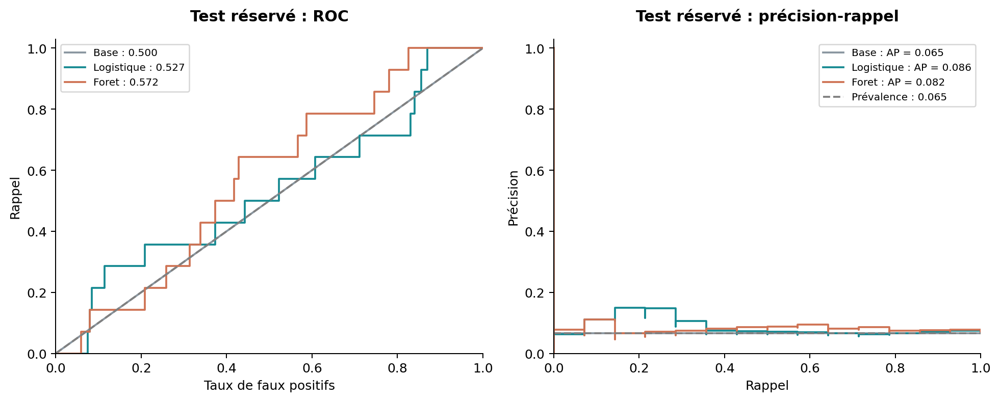

# Cervical Cancer Risk Factors — Python

Projet Python reproductible pour l'UE 5BM753. Il étudie des facteurs de risque
cervicaux afin de :

1. prédire un résultat de biopsie (`Biopsy`) à partir d'informations disponibles avant les examens ;
2. décrire des profils de dossiers par **PCA** et **k-means**.

> **Résultat principal.** La forêt aléatoire est choisie par validation croisée,
> mais son score sur le test réservé reste proche de la référence naïve. Ce projet
> ne démontre donc pas un outil clinique utilisable : il montre une démarche
> correcte, transparente et reproductible sur un petit jeu de données déséquilibré.



## Organisation du dépôt

| Dossier | Contenu |
|---|---|
| [`01_scripts`](01_scripts) | Code Python commenté : audit, prétraitement, modèles, PCA, k-means et tests. |
| [`02_data`](02_data) | CSV source intact, dictionnaire des 36 variables et découpage reproductible. |
| [`03_notebooks`](03_notebooks) | Point de départ optionnel pour Jupyter ; aucun résultat ne dépend du notebook. |
| [`04_results`](04_results) | Tableaux CSV et JSON contenant toutes les métriques calculées. |
| [`05_figures`](05_figures) | Figures Matplotlib produites automatiquement par les scripts. |
| [`06_report`](06_report) | Rapport complet en Markdown et PDF. |
| [`08_slides`](08_slides) | Présentation de 10 minutes en PDF et PPTX modifiable. |
| [`09_resources`](09_resources) | Documentation pas à pas, glossaire et références. |

Il n'y a volontairement pas de dossier Orange3 : ce dépôt est **uniquement Python**.

## Lire dans cet ordre

1. [Comprendre les données](09_resources/01_documentation/01_comprendre_les_donnees.md).
2. [Lire le protocole fixé avant les résultats](09_resources/01_documentation/00_protocole_avant_resultats.md).
3. [Lire le rapport complet](06_report/rapport_cervical_cancer.pdf).
4. [Comprendre le code](09_resources/01_documentation/09_lire_et_modifier_le_code.md).

## Exécuter le projet

Depuis la racine du dépôt, avec Python 3.12 :

```bash
python -m pip install -r requirements.txt
python 01_scripts/run_project.py
```

Les figures sont créées dans `05_figures/` et tous les tableaux dans
`04_results/tables/`. Pour vérifier les fichiers produits :

```bash
python -m unittest discover -s 01_scripts/tests -v
```

Dans Spyder, ouvre `01_scripts/run_project.py` puis exécute le fichier entier avec **F5**.
Le [guide d'installation et GitHub](09_resources/01_documentation/10_installation_github.md)
détaille aussi les étapes Windows.

## Résultats supervisés

| Méthode | AP en CV, moyenne ± écart-type | AP test | Rappel test au seuil retenu |
|---|---:|---:|---:|
| Base naïve | 0,064 ± 0,003 | 0,065 | 0 / 14 |
| Régression logistique L2 | 0,135 ± 0,029 | 0,086 | 5 / 14 |
| Forêt aléatoire, choisie en CV | 0,217 ± 0,036 | 0,082 | 2 / 14 |

La cible est rare : 55 résultats positifs sur 858 (6,4 %). L'AP est donc plus
informative que l'exactitude seule. Les détails du découpage, des imputations,
des seuils et des incertitudes sont disponibles dans le
[rapport](06_report/rapport.md) et les [tableaux](04_results/tables).

## Réutilisation et publication sur GitHub

Ce dossier est prêt à être déposé dans un nouveau dépôt GitHub. Crée d'abord un
dépôt vide sur ton compte, puis exécute depuis ce dossier :

```bash
git init -b main
git add .
git commit -m "Analyse Python des facteurs de risque cervicaux"
git remote add origin https://github.com/TON_COMPTE/cervical-cancer-risk-factors-aida.git
git push -u origin main
```

Le guide détaillé est dans
[`10_installation_github.md`](09_resources/01_documentation/10_installation_github.md).
GitHub décrit la même procédure pour publier un projet local. [Documentation officielle GitHub](https://docs.github.com/fr/migrations/importing-source-code/using-the-command-line-to-import-source-code/adding-locally-hosted-code-to-github)

## Sources

- Fernandes, Cardoso & Fernandes. [UCI Cervical Cancer (Risk Factors)](https://doi.org/10.24432/C5Z310), CC BY 4.0.
- [OMS — Cancer du col de l'utérus](https://www.who.int/fr/news-room/fact-sheets/detail/cervical-cancer).
- [Documentation scikit-learn](https://scikit-learn.org/stable/user_guide.html).

La bibliographie annotée et les limites de chaque source figurent dans
[`09_resources/REFERENCES.md`](09_resources/REFERENCES.md).
